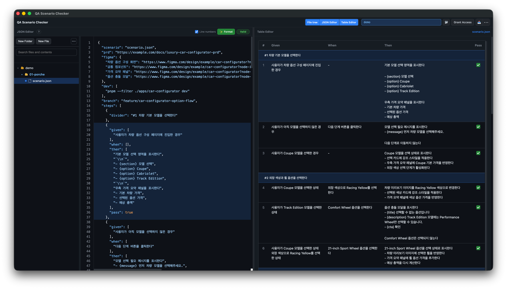

# QA Scenario Checker

[English](README.en.md)

QA Scenario Checker는 QA 시나리오 JSON을 편집하고, Given/When/Then 체크리스트 형태로 검수할 수 있는 Chrome 확장 프로그램입니다.



- [주요 기능](#주요-기능)
- [설치](#설치)
- [개발](#개발)
- [데모 폴더](#데모-폴더)
- [사용 방법](#사용-방법)
  - [시나리오 작성](#시나리오-작성)
  - [구분선 타입과 색상](#구분선-타입과-색상)
    - [markdown 라이브 표 (view)](#markdown-라이브-표-view)
    - [UI 스케치 (ui 블록)](#ui-스케치-ui-블록)
  - [문장 쓰는 법](#문장-쓰는-법)
  - [빠른 열기와 명령 목록](#빠른-열기와-명령-목록)
  - [구간으로 이동](#구간으로-이동)
  - [Table Editor 검색](#table-editor-검색)
  - [행 참조 복사](#행-참조-복사)
  - [노트 (note)](#노트-note)
    - [링크](#링크)
    - [이미지](#이미지)
    - [이미지 관리](#이미지-관리)
    - [열 선택](#열-선택)
    - [행 필터](#행-필터)
- [개발 동기](#개발-동기)
- [브라우저 호환성](#브라우저-호환성)

## 주요 기능

- JSON Editor와 Table Editor를 나란히 보며 시나리오를 편집
- `given`, `when`, `then`, `pass` 필드를 체크리스트 테이블로 표시
- 구분선(`divider`) 행과 구분선 색상, 타입(text / code) 지원
- 행별 노트(`note`) 셀에 메모, 링크, 스크린샷을 바로 입력
- 붙여넣은 이미지는 열어 둔 폴더의 `assets/`에 저장하고 하단 상태 표시줄에서 관리
- markdown code 블록의 표를 셀 UI로 편집하는 `live` 보기와 `/table` 슬래시 명령
- 화면 영역을 텍스트로 그리는 `ui` 블록(`@역할(내용)`)과 `/ui` 슬래시 명령
- 보일 열을 고르는 열 선택과 `{pass}/{total}` 진척도 표시
- Table Editor에서 Given/When/Then과 노트를 통합 검색
- 파일 트리에서 폴더/파일 생성, 이름 변경, 복사, 삭제, 검색 지원
- 폴더 또는 단일 JSON 파일 가져오기
- localStorage 자동 저장과 파일/폴더 기반 작업 흐름 지원
- 패널 표시 여부, 보일 열, 행 필터를 localStorage에 기억
- JSON 유효성 검사, 포맷팅, 라인 넘버, 오류 위치 표시
- 에디터 검색/바꾸기, 실행 취소/다시 실행, 커서 이동 히스토리
- 전체 필드 또는 선택 필드 기반 JSON 내보내기

## 설치

1. Chrome에서 `chrome://extensions`를 엽니다.
2. 오른쪽 위의 `개발자 모드`를 켭니다.
3. `압축해제된 확장 프로그램을 로드합니다`를 누릅니다.
4. 이 저장소 폴더를 선택합니다.
5. 툴바의 QA Scenario Checker 아이콘을 눌러 실행합니다.

CodeMirror 번들(`vendor/codemirror/codemirror.bundle.js`)은 저장소에 포함되어 있어서 별도 번들링 없이 바로 동작합니다.

## 개발

노트의 code 블록 편집기만 번들이 필요합니다. 에디터 설정을 바꿀 때만 다시 번들하면 됩니다.

```sh
npm install
npm run build   # src/codemirror-entry.js -> vendor/codemirror/codemirror.bundle.js
npm test
```

## 데모 폴더

| 폴더 | 커밋 | 용도 |
| --- | --- | --- |
| `demo/` | 포함 | 가상 데이터로 만든 공개 예제 |
| `demo-private/` | 제외 | 실제 제품 문서로 만든 시나리오 |

이 저장소는 공개되어 있습니다. 실제 기획 문서에서 만든 시나리오는 URL과 요구사항 원문이 그대로 남으므로 `demo-private/` 아래에 두세요. `.gitignore` 가 폴더 전체를 제외하므로 프로젝트를 추가할 때 설정을 바꿀 필요가 없습니다.

```
demo/
  assets/              노트에 넣은 이미지 (가상 화면, 커밋됨)
  01-porche/
    scenario.json      가상 예제 (커밋됨)

demo-private/          전체 제외
  amr-001-002/
    prd.md             원문 덤프
    scenario.json      원문에서 만든 시나리오
```

노트의 이미지는 연 폴더의 루트 아래 `assets/`에서 찾습니다. 데모의 이미지를 보려면 `demo/` 폴더를 루트로 여세요. `01-porche`의 1번, 5번 행 노트에 이미지 예시가 있습니다.

원문과 시나리오를 같은 폴더에 두면 대조하기 쉽고, 프로젝트가 끝나면 폴더 하나만 지우면 됩니다. 폴더를 가져올 때 `.json` 만 읽으므로 `prd.md` 가 함께 있어도 문제가 없습니다.

## 사용 방법

### 시나리오 작성

- 오른쪽 Table Editor에 내용을 작성하면 왼쪽 JSON Editor가 자동으로 갱신됩니다
- 왼쪽 JSON Editor에 시나리오 JSON을 작성하면 오른쪽 Table Editor가 자동으로 갱신됩니다

> [!TIP]
>
> [명세]-[구현]-[검증]의 개발 프로세스 3단계에서 활용하는 방법
>
> [명세]를 작성할 때는 Table Editor로 손쉽게 작성하고, 작성한 산출물을 JSON 파일 LLM 컨텍스트에 주입해서 더 정확하게 [구현]하도록 유도하고, Table Editor를 보면서 [검증]할 수 있는 개발 프로세스를 구축할 수 있습니다.

```json
{
  "scenario": "Login flow",
  "steps": [
    {
      "given": ["User is on the login page"],
      "when": ["User enters valid credentials"],
      "then": ["Dashboard is displayed"],
      "pass": false
    },
    {
      "divider": "Error cases"
    },
    {
      "given": ["User is on the login page"],
      "when": ["User enters a wrong password"],
      "then": ["An error message is displayed"],
      "pass": false
    }
  ]
}
```

### 구분선 타입과 색상

구분선은 문자열 하나로 쓰거나, 속성이 필요하면 객체로 씁니다. `type`과 `color`는 서로 독립적이며 생략하면 기본값(text, 기본 색상)입니다. Table Editor에서 구분선을 우클릭해 `타입 변경`, `색상 변경`으로 바꿀 수 있습니다.

```json
{ "divider": "Error cases" }
{ "divider": { "value": "Error cases", "color": "#f85149" } }
{ "divider": { "value": "const canLogin =\n  id.valid() && password.valid()", "type": "code" } }
```

| type | 편집 |
| --- | --- |
| `text` (기본) | 일반 텍스트. 백틱 인라인 코드와 링크(`[label](https://...)`, `⌘K`)를 렌더링합니다. 이미지는 넣을 수 없습니다 |
| `code` | CodeMirror 에디터. 들여쓰기를 보존합니다. 하이라이팅 언어는 에디터 위 선택 상자에서 고르며 기본값은 `tsx`입니다 |

언어를 기본값(`tsx`) 외의 것으로 고르면 `"lang": "json"`처럼 저장되고, 강조 없이 쓰려면 `plain`을 고릅니다. 언어 옆 `height` 선택 상자는 `fixed`(기본, 최대 300px까지 보이고 넘치면 스크롤)와 `auto`(내용 길이만큼 펼침)를 고르며, `auto`를 고르면 `"height": "auto"`로 저장되어 새로고침해도 유지됩니다. 에디터 하단 중앙의 핸들을 드래그하면 원하는 높이로 맞출 수 있고 `"height": "480px"`처럼 저장되며 선택 상자에도 그 값이 표시됩니다. 핸들을 더블클릭하면 기본 높이(`fixed`)로 돌아갑니다. 노트의 code 블록도 같은 핸들로 높이를 조절합니다. `wrap` 선택 상자는 `off`(긴 줄은 가로 스크롤)와 `on`(에디터 너비에서 자동 줄바꿈)을 고릅니다. VS Code처럼 기본값이 언어마다 달라서 `markdown`은 `on`, 그 밖의 언어는 `off`이며, 언어 기본값과 다르게 고른 경우에만 `"wrap": "off"`처럼 저장됩니다. 노트의 code 블록도 같은 언어별 기본값을 따릅니다. `wrap: on`이면 라이브 표도 에디터 너비 안에 맞춰지고 긴 셀은 줄바꿈됩니다. 알 수 없는 `type`은 text로 표시하되 값은 그대로 보존합니다.

#### markdown 라이브 표 (`view`)

언어를 `markdown`으로 고르면 에디터 위에 `view` 선택 상자가 나타납니다. 노트의 code 블록도 같습니다.

| view | 표시 |
| --- | --- |
| `live` (기본) | GFM 표를 셀 UI로 편집합니다. 표 밖의 markdown은 `source`와 똑같이 원문 그대로 보입니다 |
| `source` | 모든 내용을 원문 그대로 보여줍니다 |

`view`는 보여주는 방식만 바꾸고, 저장되는 값은 항상 markdown 원문입니다. 기본값 `live`는 저장하지 않으며 `source`를 고르면 `"view": "source"`로 저장됩니다.

```json
{ "divider": { "value": "| 구분 | 내용 |\n| -- | -- |\n| 관리자 | 모달<br>- 작성 불가 |", "type": "code", "lang": "markdown" } }
```

`live` 표에서 쓸 수 있는 조작입니다.

| 조작 | 동작 |
| --- | --- |
| 셀 클릭 | 그 셀을 바로 편집. `Enter`는 셀 안 줄바꿈이며 `<br>`로 저장됩니다 |
| `Tab` / `Shift+Tab` | 다음 / 이전 셀로 이동 |
| `Esc` | 셀에서 나와 표 아래 줄로 이동. 한 번 더 누르면 에디터에서 나갑니다 |
| 열 위쪽 경계의 핸들 | `오른쪽에 열 삽입`, `열 삭제` |
| 행 왼쪽 경계의 핸들 | `아래에 행 삽입`, `행 삭제` (헤더 행은 삭제할 수 없음) |
| 표 오른쪽 / 아래 가장자리 가운데의 `+` `-` | 맨 끝에 열 / 행 추가, 마지막 열 / 행 삭제 (열이 하나뿐이거나 본문 행이 없으면 `-`는 숨김) |
| 표 왼쪽 위 모서리 바로 위의 휴지통 | 표 전체를 지웁니다. `Cmd+Z`로 되돌릴 수 있습니다 |

행·열 추가와 삭제, 표 삭제는 각각 실행 취소 한 번으로 되돌릴 수 있습니다. 버튼을 누르면 포커스가 에디터로 옮겨지므로 바로 `Cmd+Z`를 누르면 됩니다.

새 표는 줄 맨 앞이나 공백 뒤에서 `/`를 입력해 자동완성에서 `/table`을 고르면 삽입됩니다. `source`에서도 같은 명령으로 빈 표 원문이 들어갑니다. `a/b`처럼 글자 바로 뒤의 `/`나 코드 안의 `/`에서는 목록이 뜨지 않습니다.

셀 안의 `` `code` ``나 `**굵게**`는 원문 줄과 같은 색으로 강조되고, 셀을 클릭하면 원문을 편집합니다. 표를 고치면 그 표 부분만 `| a | b |` 형식으로 다시 쓰고, 표 밖의 markdown은 건드리지 않습니다.

#### UI 스케치 (`ui` 블록)

markdown 구분선 안에서 화면의 한 영역을 텍스트로 그립니다. 내용마다 그 자리의 **역할**을 붙여 쓰면, `live` 보기에서 역할 이름이 내용 위에 작게 얹혀 보입니다. 저장되는 값은 아래 원문 그대로입니다.

````markdown
```ui
@title(시간표 설정) --- @cta01([학생 시간표 반영 설정]) @cta02([[시간표 일괄 삭제]])
@description(주차별 감독 시간을 등록할 수 있습니다.)

@additional-info(@badge(코스 운영기간 {startAt} ~ {endAt}))
```
````

| 문법 | 뜻 |
| --- | --- |
| `@역할(내용)` | 괄호 안이 그 역할의 범위입니다. 역할 안에 역할을 넣을 수 있습니다 |
| `@역할"내용"` | 따옴표 안이 범위입니다. 내용에 괄호가 들어갈 때 편합니다. 따옴표 안에는 따옴표 역할을 넣을 수 없고, 괄호 역할은 넣을 수 있습니다 |
| `@역할 내용` | 괄호와 따옴표를 생략하면 다음 `@역할`, `---`, 줄 끝 중 먼저 나오는 곳까지입니다 |
| `@역할:조건"내용"` | 역할이 나타나는 조건이나 상태(directive)를 붙입니다. `:` 뒤부터 여는 `"`나 `(` 앞까지이며 띄어쓰기를 쓸 수 있습니다 |
| `---` | 뒤따르는 내용을 줄의 반대쪽 끝으로 밉니다 |
| `--` | 다음 칸을 시작합니다. 블록 안 모든 줄의 n번째 `--`가 같은 세로선에 놓입니다 |
| `[텍스트]`, `[[텍스트]]` | 버튼, 강조 버튼 |
| `{이름}` | 나중에 값이 들어갈 변수. 한글 이름도 됩니다(`{날짜}`) |
| 빈 줄 | 세로 간격 |

`--`로 줄 사이의 세로 위치를 맞춥니다. 아래에서 `D`는 `B` 바로 밑에 옵니다.

````markdown
```ui
A -- B --- C
-- D
```
````

- 각 줄의 마지막 칸은 오른쪽 끝까지 차지합니다. 그래서 `--`가 없는 줄은 전체 폭을 쓰고, `---`도 지금처럼 끝까지 밉니다.
- 칸의 폭은 뒤에 `--`가 더 이어지는 내용 중 가장 긴 것에 맞춰집니다. 줄의 마지막 칸에 있는 내용은 길어도 다른 줄의 칸을 밀어내지 않습니다.
- `--`는 줄의 바깥에서만 칸을 나눕니다. `@range(1 -- 10)`처럼 역할 안에 있으면 글자입니다. 앞뒤에 공백이 있어야 하고, 글자로 쓰려면 `\--`로 씁니다.

directive는 "전체 미반영을 골랐을 때만 보인다", "비활성 상태다"처럼 그 요소가 언제 어떤 상태로 나타나는지를 적는 자리입니다.

````markdown
```ui
@radio"전체 반영" -- @radio"전체 미반영"

@description:전체 미반영 선택 시"전체 미반영 할 수 없는 일정"
--- [취소] @cta:disabled:변경 없음([[적용]])
```
````

- 역할 이름 옆에 다른 색의 작은 꼬리표로 보입니다. 그림은 내용을 숨기거나 바꾸지 않고, 뜻은 역할 이름처럼 자유롭게 정합니다.
- `:`를 이어 쓰면 여러 개가 됩니다.
- directive를 쓰면 `"내용"`이나 `(내용)`이 반드시 따라와야 합니다. 괄호 없는 줄임 표기와는 같이 쓸 수 없고, 그렇게 쓴 줄은 이유와 함께 빨갛게 표시됩니다.
- directive 안에 `"`, `(`, `:`를 글자로 쓰려면 앞에 `\`를 붙입니다.

- 역할 이름은 영문자로 시작하고 영문자·숫자·`-`·`_`를 씁니다. 이름은 자유롭게 짓습니다. 역할은 자리의 이름일 뿐이라 어떤 이름에도 정해진 모양이 없습니다. 같은 `title`이라도 화면마다 생김새가 다르기 때문입니다.
- `@`는 단어 첫머리에서만 역할입니다. `example@mail.com`의 `@`는 내용입니다.
- 내용 안의 괄호는 짝이 맞으면 그대로 씁니다. 기호를 글자 그대로 쓰려면 `\)`, `\"`, `\@`, `\[`처럼 앞에 `\`를 붙입니다.
- 닫는 괄호나 따옴표가 없는 줄은 그 줄만 원문 그대로 빨갛게 표시하고, 나머지 줄은 정상적으로 그립니다.

블록 위 막대의 `?`에 마우스를 올리면 위 문법 표가 뜹니다. 클릭하면 고정되고, 다시 클릭하거나 `Esc`, 바깥 클릭으로 닫습니다.

블록 위 막대에서 보기를 바꿉니다. `역할 + 내용`(기본), `내용만`, `역할만`(자리 이름만 남긴 뼈대) 중에서 고르며, 고른 보기는 모든 `ui` 블록에 적용되고 localStorage에 기억됩니다.

원문 입력란에서 내용을 선택하고 `(`나 `"`를 누르면 그 기호로 감쌉니다. `@title 시간표 설정`에서 `시간표 설정`을 선택했다면 사이의 공백을 없애 `@title(시간표 설정)`으로 만듭니다.

그림에 직접 입력할 수는 없습니다. `</>` 버튼이나 그림 더블클릭으로 원문 입력란을 열어 고치고, `Esc`로 닫습니다. 줄 맨 앞이나 공백 뒤에서 `/ui`를 고르면 예시가 든 새 블록이 들어가고 원문 입력란이 바로 열립니다. `삭제` 버튼은 블록을 지웁니다(실행 취소로 복구).

##### 셀 안에서 쓰기

Given/When/Then/Note 셀에도 같은 ` ```ui ` 펜스를 쓸 수 있습니다. 구분선 행을 따로 만들지 않고 그 행의 셀 안에 작게 그립니다.

````
코스에 등록된 Zoom 계정 선택 select box가 표시된다

```ui
@radio({radio}) -- @label({email}) --- @count-ui(({assignedCourses.length}/2))
-- @detail"현재 등록된 코스: {courseTitle}"
```
````

- 펜스 앞뒤의 글은 평소처럼 보이고, 펜스 부분만 그림으로 바뀝니다. 한 셀에 여러 개를 넣을 수 있습니다.
- 셀을 편집하는 동안에는 원문이 보입니다. 그림을 눌러도 편집 상태가 됩니다.
- 그림은 셀 폭에 맞춰 줄이지 않고 제 폭대로 그립니다. 셀보다 넓으면 열을 넓히지 않고 그림 안에서 가로로 스크롤됩니다. 다만 그림 폭은 480px까지만 늘어나고, 그보다 긴 글은 그 폭에서 줄바꿈됩니다.
- 보기 전환(`역할 + 내용`/`내용만`/`역할만`)은 markdown 구분선의 블록에서 고르며, 셀의 그림에도 함께 적용됩니다.
- 셀에는 막대(`?`, `</>`, `삭제`)와 `/ui` 자동완성이 없습니다. 펜스를 직접 입력합니다.

### 문장 쓰는 법

셀의 첫 줄에서 `↑`를 누르면 윗행의 같은 열로, 마지막 줄에서 `↓`를 누르면 아랫행의 같은 열로 커서가 옮겨 갑니다. 줄이 여러 개인 셀 안에서는 평소처럼 줄 사이를 움직이고, 열 폭 때문에 자동으로 꺾인 줄도 한 줄로 칩니다. 구분선 행에서는 제목(Note 열에서는 구분선의 노트)으로 들어가고, code 구분선은 건너뜁니다.

셀에서 텍스트를 선택한 채 여는 기호 `(` `[` `{` `` ` `` `"` `'` 를 입력하면 선택한 부분을 그 기호로 감쌉니다. Given/When/Then/Note 셀, text 구분선, markdown 표의 셀, 코드 편집기에서 모두 같습니다. 실행 취소는 닫는 기호와 여는 기호를 한 번씩 되돌립니다.

given/when/then은 **화면을 쓰는 사람** 기준으로 씁니다. 기획서 문장을 그대로 옮기면 시스템이 주어가 되어 무엇을 확인해야 하는지 흐려집니다.

| | 이렇게 |
| --- | --- |
| given | 누구인지 밝힙니다. `시스템관리자가 ~한 상태` |
| when | 손으로 만지는 것을 씁니다. `로그인 버튼을 누른다` |
| then | 눈에 보이는 것을 씁니다. `~가 보인다`, `~로 넘어가지 않는다` |

```
before
  given  클라이언트 검증을 우회해 요청을 보낸 상태
  when   서버에 저장을 요청한다
  then   서버에서도 동일한 규칙을 검증한다

after
  given  담당자가 비밀번호 재설정 화면을 연 상태
         개발자 도구로 입력칸 검사를 꺼 둔 상태
  when   규칙에 맞지 않는 비밀번호를 넣고 변경 버튼을 누른다
  then   비밀번호가 바뀌지 않는다
         다시 로그인하면 이전 비밀번호로 들어가진다
```

화면에 드러나지 않는 동작은 결과로 바꿔 씁니다. 그래도 확인할 수 없으면 시스템 문장을 두되 `화면 밖 검증` 노트를 답니다.

만들 단위가 눈에 보이도록 컴포넌트 이름을 `tip` 노트로 답니다. `로그인 폼`, `ID 필드`, `계정 목록 표` 처럼 적으면 `단위` 필터로 모아 볼 수 있습니다.

### 빠른 열기와 명령 목록

`⌘P`로 빠른 열기 창을 엽니다. 글자를 치면 파일을 찾고, 맨 앞에 `>`를 치면 명령 목록으로 바뀝니다. `>`를 지우면 다시 파일 검색입니다. `⌘⇧P`는 `>`가 입력된 상태로 엽니다.

명령마다 화면에 쓰는 한글 문구, 영어 이름, 단축키가 함께 보이고, 한글과 영어 어느 쪽으로 검색해도 찾습니다(`> 구간`, `> section`).

| 명령 | 영어 이름 | 단축키 |
| --- | --- | --- |
| 파일 열기 | Open File | `⌘P` |
| 구간으로 이동 | Go to Section | `⌘⇧O` |
| 새 파일 | New File | `⌘⌥N` |
| 표에서 검색 | Find in Table | `⌘F` |
| 표에서 찾아 바꾸기 | Replace in Table | `⌘⌥F` |
| 선택한 행 참조 복사 | Copy Row Reference | |
| 구분선만 보기 토글 | Toggle Dividers Only | |
| Sticky 제목 토글 | Toggle Sticky Headings | |
| 파일 트리 토글 | Toggle File Tree | `⌘B` |
| JSON Editor 토글 | Toggle JSON Editor | |
| Table Editor 토글 | Toggle Table Editor | |
| 이미지 관리 | Manage Images | |
| 폴더 열기 | Open Folder | |
| JSON 정리 후 저장 | Format and Save JSON | |
| 키보드 단축키 보기 | Show Keyboard Shortcuts | |

지금 실행할 수 없는 명령은 목록에 나오지 않습니다. `선택한 행 참조 복사`는 행을 선택했을 때만 보입니다.

### 구간으로 이동

`⌘⇧O`/`Ctrl+Shift+O`를 누르면 시나리오의 구간 목록이 뜹니다. 구간은 text 구분선이고, 목록은 파일에 적힌 순서 그대로인 목차입니다. 명령 팔레트(`⌘⇧P`)의 `구간으로 이동`으로도 엽니다.

- 글자를 치면 제목에 그 단어들이 모두 든 구간만 남습니다.
- `↑` `↓`로 고르고 `Enter`로 이동합니다. 목록은 지금 있는 구간이 선택된 채로 열리고, 그 구간에는 `현재 구간`이 표시됩니다.
- 오른쪽 숫자는 그 구간에서 통과한 행 / 전체 행입니다. 앞의 점은 구분선 색입니다.
- 이동하면 그 구분선이 표 맨 위로 오고 선택됩니다. 행 필터가 그 구분선을 숨기고 있으면 `All rows`로 바뀝니다.
- code 구분선은 구간 안의 내용이라 목록에 나오지 않습니다. 구분선 제목에 넣은 링크는 이름만 보입니다.

### Table Editor 검색

Table Editor 헤더의 `Search` 버튼으로 현재 시나리오를 검색합니다. Table Editor를 마지막으로 사용한 상태에서는 `⌘F`/`Ctrl+F`로도 열 수 있습니다. JSON Editor에 포커스가 있으면 기존 JSON 검색이 열립니다.

검색 범위는 구분선 제목, Given, When, Then, 그리고 행과 구분선의 노트입니다. 노트는 링크 주소와 이미지 경로까지 포함한 원문을 검색합니다. 여러 키워드는 순서와 관계없이 모두 포함된 항목을 찾고 대소문자를 구분하지 않습니다. 검색은 표시만 바꾸며 원문 JSON을 수정하지 않습니다.

결과에는 Step, 필드와 원문 일부가 표시됩니다. 결과를 선택하면 해당 행으로 이동하고, 숨긴 열에서 찾은 경우 그 열을 다시 보이게 합니다. 현재 행 필터가 결과를 숨기고 있으면 `All rows`로 전환합니다. `Enter`/`Shift+Enter` 또는 화살표 버튼으로 다음/이전 결과를 이동하고 `Esc`로 검색을 닫습니다.

#### 바꾸기

검색 줄의 `Replace` 버튼이나 `⌘⌥F`/`Ctrl+H`로 바꾸기 줄을 엽니다.

| 버튼 | 동작 |
| --- | --- |
| `이 셀 바꾸기` (`Enter`) | 현재 선택된 검색 결과의 셀 안에서 모두 바꿉니다. 바꾼 뒤에는 다음 결과가 선택됩니다 |
| `모두 바꾸기` | 시나리오 전체에서 바꿉니다. 몇 곳인지 보여주고 확인을 받습니다 |

- 바꾸기는 검색어를 **한 구절**로 봅니다. 대소문자는 구분하지 않습니다. 검색은 키워드를 순서와 관계없이 찾으므로, 키워드를 여러 개 쓰면 검색 결과에는 나오지만 바꿀 곳은 없는 셀이 있을 수 있습니다. `바꿀 곳 N`이 실제로 바뀌는 수입니다.
- 대상은 Given, When, Then, 노트, 구분선의 제목과 내용입니다. 노트의 링크 주소와 이미지 경로도 글자로 취급하므로, 주소에 들어 있는 단어를 바꾸면 링크가 달라집니다.
- 바꿀 내용을 비우면 그 구절을 지웁니다.
- Table Editor에는 실행 취소가 없습니다. `모두 바꾸기` 전에 저장하거나 버전 관리로 되돌릴 수 있게 해 두세요.

### 행 참조 복사

시나리오의 행 몇 개를 다른 도구(리뷰 메모, 에이전트 대화 등)에 넘길 때 씁니다. 행을 고르고 복사하면 클립보드에 JSON이 들어갑니다.

| 동작 | 결과 |
| --- | --- |
| 행 클릭 | 그 행 하나를 선택. 하나만 선택된 행을 다시 클릭하면 선택 해제 |
| `⌘`/`Ctrl` + 클릭 | 선택에 더하거나 빼기 |
| `Shift` + 클릭 | 마지막으로 누른 행부터 그 행까지 범위 선택 |
| `⌘C`/`Ctrl+C` | 선택한 행의 참조를 복사 (셀을 편집 중이거나 글자를 선택한 상태가 아닐 때) |
| 우클릭 → `행 N개 참조 복사` | 같은 동작. 선택 밖의 행을 우클릭하면 그 행만 선택됩니다 |

text 구분선을 선택하면 그 구간 전체, 곧 다음 text 구분선 전까지의 모든 행과 code 구분선을 뜻합니다. code 구분선을 선택하면 그 구분선 자체를 뜻하며, `divider` 내용이 그대로 담기고 `number`는 `null`입니다.

```json
{
  "qsc": "rows",
  "file": "lms-ai-campus/proctor/02-course-proctor.json",
  "scenario": "KDT 수업감독 기능 추가",
  "rows": [
    {
      "id": "r-kfpz",
      "number": 3,
      "section": "#1 수업 감독 활성화",
      "given": ["-"],
      "when": ["토글 > true"],
      "then": ["select box 표시"],
      "pass": false
    }
  ]
}
```

- `rows`의 내용은 복사한 시점의 스냅샷입니다. `file`과 `id`가 참조이며, 나중에 그 파일에서 같은 `id`의 행을 찾으면 최신 내용을 볼 수 있습니다.
- `id`는 복사할 때 그 행에 없으면 만들어 시나리오 JSON에 저장합니다. 행을 끼워 넣거나 지워도 바뀌지 않습니다. 복사한 적 없는 행에는 붙지 않습니다. `number`는 사람이 보기 위한 순번이라 행이 추가되면 달라집니다.
- `section`은 그 행이 속한 text 구분선의 제목입니다. code 구분선은 구간을 나누지 않습니다.
- `file`은 연 폴더의 이름부터 시작하는 경로입니다. 브라우저는 폴더의 실제 경로를 알려주지 않으므로, 절대 경로가 필요하면 하단 상태 표시줄의 폴더 항목을 눌러 실제 경로를 한 번 적어 둡니다. 폴더 이름별로 기억합니다.

### 노트 (`note`)

시나리오가 어떤 원문에서 나왔는지, 무엇을 확인해야 하는지 기록하는 열입니다. Given/When/Then과 같은 방식으로 셀을 클릭해 바로 입력하고, 타이핑하는 즉시 저장됩니다. 헤더의 열 선택에서 Note를 해제하면 열을 숨길 수 있습니다.

```json
{
  "given": ["초기 비밀번호가 발급된 상태"],
  "when": ["초기 비밀번호로 로그인한다"],
  "then": ["비밀번호 재설정 화면으로 이동한다"],
  "pass": false,
  "note": [
    "[PRD AC-02](https://example.com/prd#ac-02) ",
    "`[!caution]` 문구가 Figma와 다름"
  ]
}
```

text 구분선에도 같은 방식으로 노트를 쓸 수 있습니다. 구분선 제목은 Note 열 앞까지만 차지하고, Note 칸에는 그 구간에 대한 메모·링크·이미지를 넣습니다. code 구분선은 표 전체 폭을 쓰므로 Note 칸이 없습니다.

```json
{ "divider": "#1 로그인", "note": ["[Figma](https://example.com/figma) "] }
```

`note`는 줄 단위 문자열 배열이며 생략할 수 있습니다. 내용을 모두 지우면 키도 사라집니다. 저장되는 값은 markdown 문법 그대로라서 JSON Editor에서도 읽고 고칠 수 있습니다.

| 문법 | 표시 |
| --- | --- |
| `[label](https://...)` | 링크 칩. 클릭하면 새 탭에서 엽니다 |
| `https://...` | 링크 칩. 도메인을 이름으로 씁니다 |
| `` | 이미지 칩. 올리면 미리보기, 클릭하면 전체 화면 |
| `` `[!warning]` `` | 다른 셀과 같은 alert 토큰 |

긴 링크나 이름이 들어가도 Note 열의 폭은 늘어나지 않습니다. 칩은 열 폭에 맞춰 가운데를 `…`로 줄여 앞과 끝을 함께 보여주고(`GET … -host-accounts`), 전체 이름과 주소는 칩에 마우스를 올리면 나옵니다. 편집 중인 원문은 열 폭 안에서 줄바꿈됩니다.

셀을 편집하는 동안에는 칩 대신 원문이 보입니다. 칩을 클릭하면 링크나 이미지가 열리므로, 편집하려면 셀의 빈 곳을 클릭합니다. 이미지는 노트 열에서만, 링크는 노트 열과 text 구분선에서만 칩으로 바뀝니다.

이전 버전의 `notes`, `sharedNotes`(패널에서 편집하던 노트)는 더 이상 읽지 않습니다. 파일에 남아 있어도 지우지 않고 그대로 둡니다.

#### 링크

- `⌘K`/`Ctrl+K`: URL과 label을 입력하는 창을 엽니다. 텍스트를 선택한 상태면 label로 채워지고, 캐럿이 기존 링크 안에 있으면 그 링크를 수정합니다. label을 비우면 주소만 넣습니다.
- 텍스트를 선택하고 URL을 붙여넣으면 선택한 텍스트가 label인 링크가 됩니다.
- `http://`, `https://` 주소만 링크가 됩니다.

#### 이미지

노트 셀에 클립보드의 이미지를 붙여넣으면(`⌘V`) 파일로 저장하고 그 자리에 ``을 넣습니다. Figma의 Copy as PNG, 화면 캡처 모두 같은 방식입니다.

- 저장 위치는 **열어 둔 폴더의 루트 아래 `assets/`**입니다. 경로가 루트 기준이라 시나리오 파일을 폴더 안에서 옮겨도 깨지지 않고, 여러 시나리오가 같은 이미지를 참조할 수 있습니다.
- 폴더를 열고 쓰기 권한을 허용한 상태에서만 동작합니다. 그렇지 않으면 상태 표시줄에 이유를 표시하고 아무것도 저장하지 않습니다.
- 파일명은 붙여넣은 시각(`20261116-143205.png`)입니다. 칩에 보이는 이름은 대괄호 안의 label이며, 비워 두면 파일명을 보여줍니다.
- PNG, JPEG, GIF, WebP를 지원하고 10 MB까지 저장합니다. 형식은 파일 내용으로 판별합니다.
- ``처럼 웹 주소를 쓴 이미지도 같은 칩으로 보여줍니다.

다른 폴더를 루트로 열면 `assets/` 위치가 달라져 이미지를 찾지 못합니다. 항상 같은 폴더를 루트로 여세요. 버전 관리를 한다면 `assets/`도 함께 커밋됩니다. 공개 저장소라면 실제 기획 화면이 올라가지 않도록 `.gitignore`를 확인하세요.

#### 이미지 관리

화면 하단 상태 표시줄의 `Images` 항목이 `assets/`의 이미지 수와 미사용 수를 보여줍니다. 클릭하면 목록이 열립니다.

| 항목 | 설명 |
| --- | --- |
| 섬네일 | 클릭하면 전체 화면으로 봅니다 |
| 사용 | 이 이미지를 참조하는 시나리오 파일 이름. 없으면 `미사용` |
| 참조 복사 | ``을 클립보드에 복사합니다 |
| 삭제 | 파일을 지웁니다. 사용 중이면 어디서 쓰는지 알리고 확인을 받습니다 |
| 미사용 N개 삭제 | 어떤 시나리오도 참조하지 않는 이미지를 한 번에 지웁니다 |

이미지는 자동으로 지워지지 않습니다. 노트에서 참조를 지워도 파일은 남으며, 실행 취소나 버전 관리로 참조가 되살아날 수 있기 때문입니다. 사용 여부는 열어 둔 폴더의 `.json` 시나리오만 확인합니다.

파일명을 바꾸려면 파일 탐색기에서 이름을 바꾸고 노트의 경로를 직접 고칩니다.

#### 열 선택

헤더의 `All columns` 드롭다운에서 보일 열을 고릅니다. Given, When, Then, Pass, Note가 기본으로 모두 체크되어 있고, 체크를 풀면 그 열이 표에서 사라집니다. 데이터는 그대로이고 표시만 바뀝니다.

- 열을 하나라도 숨기면 버튼이 `Columns 4/5`처럼 바뀌고 색이 입혀집니다. 행 필터도 `All rows`가 아닐 때 같은 방식으로 표시되므로, 헤더만 봐도 표가 전부를 보여주는지 알 수 있습니다.
- 마지막으로 남은 열은 숨길 수 없습니다. `#` 열은 항상 보입니다.
- 숨긴 열의 폭은 남은 글 열들이 나눠 갖습니다.
- 고른 상태는 localStorage에 저장됩니다.

#### 행 필터

헤더의 드롭다운으로 보고 싶은 행만 남깁니다.

| 선택 | 남는 행 |
| --- | --- |
| `All rows` | 전체 |
| `Dividers only` | 구분선만. 시나리오 구조를 한눈에 봅니다 |
| `Note` ~ `Caution` | Given/When/Then/Note 중 어느 셀에든 그 alert 토큰(`` `[!warning]` `` 등)이 있는 행 |

구분선은 그 아래에 남은 행이 있을 때만 함께 보입니다. 빈 구간의 제목이 떠 있지 않습니다.

행 번호는 전체 기준을 그대로 씁니다. `2, 4, 5, 7, 14` 처럼 건너뛰므로 걸러낸 행이 전체에서 어디쯤인지 알 수 있습니다.

고른 필터는 localStorage에 저장됩니다. 목록은 위아래 방향키로 옮겨 다니고 `Esc` 로 닫습니다.

## 개발 동기

situations:

- AI의 발전에 따라 개발 프로세스인 [명세]-[구현]-[검증]의 3단계 과정에서 [구현]이 AI로 쉽게 대체되면서 [명세]와 [검증]의 중요성의 더 높아진 상황이었습니다.
- 평소에도 [명세]와 [검증]의 중요성을 고려해서 Google Sheet에 given/when/then 구조로 QA 시나리오로 작성하여 ATDD 방식으로 개발하고 있었으나, Google Sheet는 AI에게 컨텍스트로 전달하기에 데이터 구조가 적절하지 않아서 프롬프트 입력 비용이 큰 상황이었습니다.
- LLM이 이해하기에 훨씬 더 나은 데이터 구조인 JSON을 선택하되, 사람이 요구사항을 작성하고 검증하려면 Sheet UI가 더 적합하다고 판단했습니다.

actions:

- ATDD와 AI 활용을 함께 유지하기 위해 QA 시나리오를 JSON으로 관리하면서도 사람이 Sheet UI로 작성하고 검증할 수 있는 QA Scenario Checker 크롬 익스텐션 제작했습니다.
- QA Scenario Checker 크롬 익스텐션으로 [명세]를 손쉽게 작성하고, 작성한 산출물을 JSON 파일로 AI 컨텍스트로 주입하여 더 정확하게 [구현]하도록 유도하고, 구현된 내용을 [검증]하는 개발 프로세스를 구축했습니다.

## 브라우저 호환성

Chrome 확장 프로그램으로 사용하는 것을 기준으로 합니다. 폴더 직접 열기와 쓰기 권한은 브라우저의 File System Access API 지원 여부에 따라 동작이 달라질 수 있습니다.
